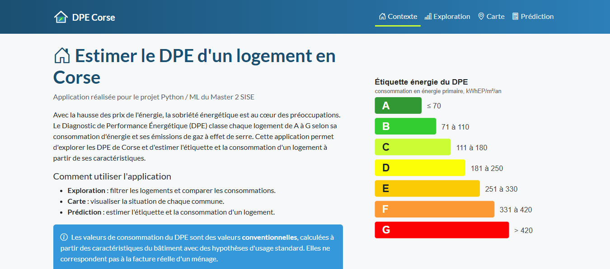

# <center style="color: yellow;" > DPE Corse — prédire l'étiquette DPE d'un logement (projet_ml_sise) </center>
 
### <center style="color: red;">Université Lumière Lyon 2</center>
### <center style="color: red;">Master 2 SISE</center>
*<center style="color: red;">Annnée : 2026-2027</center>*


**<center style="color: yellow;" >Projet de machine learning : à partir des caractéristiques d'un logement corse**</center>

<center>Fait par </center>
<hr>

* **Serigne Saliou THIAM**
* **Yassine ZAHI**
<hr>

on estime

- **<span style="color: red;">son étiquette DPE (A à G)<span>** : classification ;
- **<span style="color: red;">sa consommation en énergie primaire (kWhEP/m²/an)<span>** : régression.

Les modèles alimentent une **application web Dash**, conteneurisée avec Docker et déployée sur **Render** : <https://dpe-corse-latest.onrender.com/> (offre gratuite, ouverture parfois lente). Les données viennent de l'API ADEME : DPE des logements existants et neufs de Corse (≈ 49 000 logements).

## 1. Ce qui a été réalisé

| Étape | Réalisations | Où |
|---|---|---|
| **Collecte** | Téléchargement paginé depuis l'API ADEME (existants et neufs, filtre Corse côté serveur), colonnes ciblées, reprises en cas d'erreur | `src/data/extraction.py` |
| **Audit des données** | Comparaison des schémas neuf/existant, qualité (valeurs manquantes, doublons, dates, versions), vérification que l'étiquette se recalcule bien à partir des seuils officiels, contrôle du géocodage | notebook 01 |
| **Prétraitement** | Valeurs impossibles mises à NaN, regroupement des libellés (ex. 38 types de ventilation), diagnostic des quasi-doublons, **découpage 80/20 groupé par adresse** et stratifié, contrôle des fuites de données | notebook 02, `transformateurs.py` |
| **Sélection des variables** | Corrélations, lien avec la consommation (Spearman), importance d'une forêt aléatoire, sur le train uniquement : **23 variables** retenues | notebook 02 |
| **Enrichissement open data** | Normales climatiques 1991-2020 par commune (température, précipitations) rattachées aux logements ; évaluation avec des **témoins mélangés** pour savoir si la météo apporte vraiment quelque chose | notebook 05, `enrichissement_meteo.py` |
| **Modélisation** | Classification et régression : comparaison de modèles (référence, linéaire, forêt aléatoire, gradient boosting) en validation croisée groupée, réglage léger, évaluation unique sur le test avec intervalle de confiance par rééchantillonnage des adresses, analyse par classe et par segment, étiquette déduite de la consommation, modèle des émissions de GES | notebooks 03 et 04 |
| **Interprétation** | Importance par permutation, effet moyen d'une variable, explication d'un logement par rapport à une référence, focus sur les passoires F/G | notebook 06 |
| **Application web** | Quatre pages (Contexte, Exploration, Carte OpenStreetMap, Prédiction), filtres dynamiques, graphiques interactifs, exports CSV et PNG | `app/` |
| **Déploiement** | Image Docker (gunicorn), service web Render, application en ligne | `Dockerfile` |
| **Qualité** | Tests unitaires, graine fixe (42) et identifiants du découpage conservés, configuration centralisée, documentation technique et fonctionnelle | `tests/`, `docs/` |

| Tâche | Modèle | Résultat sur le test |
|---|---|---|
| Classification | Gradient boosting | F1 macro 0,52 · exactitude 63,6 % · à une classe près 93,7 % |
| Régression | Gradient boosting | R² 0,78 · MAE 26,7 · RMSE 41,8 kWh/m²/an |
| Classification | CatBoost (piste) | F1 macro 0,52 · exactitude 66,4 % |

Référence naïve : F1 macro 0,08 et R² ≈ 0. Déduire l'étiquette de la consommation prédite donne un F1 de 0,48, moins bien que la classification directe, car les émissions de GES décident de l'étiquette dans 13,8 % des cas. La météo apporte un gain faible en classification (F1 0,513 → 0,521) et aucun en régression (`src/models/decision_meteo.json`).

**NB** Pour la classification le model foret aléatoire est legèrement meilleur que le mais c'est trop lourd ducoup on a choisi Gradient boosting qui est plus leger pour le deploiement en mode gratuit (on utiise la version gratuit de render)

### Pour en savoir sur le contexte et la méthodologie de la construction des modèles retenus. 
 *consulter le rapport rapport sur les modèles ML : [`rapport_ml_DPE_Corse.md`](docs/rapport_ml_DPE_Corse.md).*


## 2. Architecture


*Schéma  : [`docs/architecture.drawio`](docs/architecture.drawio) (à ouvrir avec [diagrams.net](https://app.diagrams.net)).*

- **Une seule source de vérité** : périmètre, colonnes, cibles et seuils se changent dans `src/utilis/config.py`.
- **Transformations importables** : elles vivent dans `src/data/transformateurs.py`, car un pipeline sauvegardé avec joblib ne garde qu'une référence vers ses fonctions. Elles doivent donc être présentes dans l'image Docker.
- **Pas de fuite** : l'étiquette dérive de la consommation et des GES, qui ne servent jamais de variables explicatives. Le préprocesseur est ajusté sur le train uniquement, et toutes les lignes d'une même adresse restent du même côté du découpage.
- **Application découplée** : elle ne lit jamais `train.csv` ni `test.csv`, seulement les deux fichiers légers de `app/data/`.

## 3. L'application



*Mode d'emploi illustré : [`docs/DOCUMENTATION_FONCTIONNELLE.md`](docs/DOCUMENTATION_FONCTIONNELLE.md).*

Quatre pages (`app/pages/`) : **Contexte**, **Exploration** (filtres, indicateurs, graphiques, tableau, export CSV), **Carte** (communes, détail au clic) et **Prédiction**.

La page Prédiction envoie la saisie à `src/models/predict.py` (classe `Predicteur`, chargée une seule fois par processus). Elle affiche l'étiquette, la probabilité de chaque classe, la consommation estimée avec une fourchette (80 % des erreurs du test) et les variables qui pèsent le plus. Les champs vides sont traités comme « inconnu ».

`scripts/preparer_donnees_app.py` produit `app/data/logements_app.csv.gz` (≈ 0,7 Mo, une ligne par logement, position moyenne de la commune, sans adresse) et `app/data/formulaire.json` (valeurs possibles, références, erreurs typiques).

## 4. Déploiement (Docker / Render)

```bash
docker build -t dpe-corse .
docker run --rm -p 8050:8050 dpe-corse          # http://localhost:8050
```

- **Image** : `python:3.12-slim`, dépendances de `requirements-app.txt`, utilisateur sans privilèges, `gunicorn app.app:server` avec 1 processus et 4 fils (les modèles sont chargés une fois, timeout 120 s).
- **Render** : service web de type Docker, construit depuis le `Dockerfile` à la racine. Le port est lu dans `$PORT` (8050 par défaut).
- **À fournir avant la construction** : `src/models/modele_classification.joblib`, `src/models/modele_regression.joblib`, `app/data/logements_app.csv.gz` et `app/data/formulaire.json`.
- **Version de scikit-learn** : un fichier joblib se recharge avec la version qui l'a produit, à figer dans `requirements-app.txt`.

## 5. Structure du dépôt

```
projet_ml_sise/
├── app/           application Dash : app.py, pages/, graphiques.py, composants.py, donnees.py,
│                  libelles.py, assets/ · data/ (logements_app.csv.gz, formulaire.json)
├── docs/          architecture.drawio/.svg · DOCUMENTATION_FONCTIONNELLE.md · img/
├── notebooks/     01 exploration · 02 prétraitement · 03 classification · 04 régression
│                  05 météo · 06 interprétation · audit_variables_yassine (CatBoost)
├── scripts/       preparer_donnees_app.py
├── src/
│   ├── data/      extraction · transformateurs · préparation et enrichissement météo
│   │              raw/ · processed/ (train.csv, test.csv, split_ids.csv…)
│   ├── models/    predict.py · modèles .joblib · metriques_*.json · variables_retenues*.json
│   └── utilis/    config.py · regles_dpe.py
├── models/        resultats_yassine_catboost.json
├── tests/         test_transformateurs.py · test_meteo.py
├── Dockerfile · requirements.txt (travail) · requirements-app.txt (application)
```

## 6. Développement local

Prérequis : Python ≥ 3.9 (3.12 dans l'image). Commandes à lancer **depuis la racine**.

```bash
python -m venv .venv && source .venv/bin/activate
pip install -r requirements.txt -r requirements-app.txt pytest

python -m src.data.extraction --jeu tous        # téléchargement → src/data/raw/
# notebooks 01 → 06 : train/test, modèles dans src/models/, météo, interprétation
python src/data/preparer_meteo_corse.py          # préparation de la météo (voir SOURCE_METEO.md)
python scripts/preparer_donnees_app.py           # fichiers légers de l'application
python -m app.app                                # http://127.0.0.1:8050
python -m pytest tests
```

Le CSV des normales climatiques (`fr_climate_normals_1991_2020.csv`) se télécharge à part et se place dans `src/data/raw/`.

## 7. Limites connues

- **Modèles absents du dépôt** : 
- **Classes F/G mal détectées** : rappel de 30 % avec CatBoost et biais de −135 kWh/m² sur la classe G.
- **Décision météo ambiguë** : retenue en classification (gain de 0,009, du même ordre que l'écart-type entre plis), mais absente de la liste de variables des modèles.

## 8. Sources

- DPE : [ADEME, plateforme data-fair](https://data.ademe.fr) (`dpe03existant`, `dpe02neuf`).
- Météo : normales climatiques 1991-2020 par commune, Weatheo (ERA5-Land), licence CC BY 4.0.