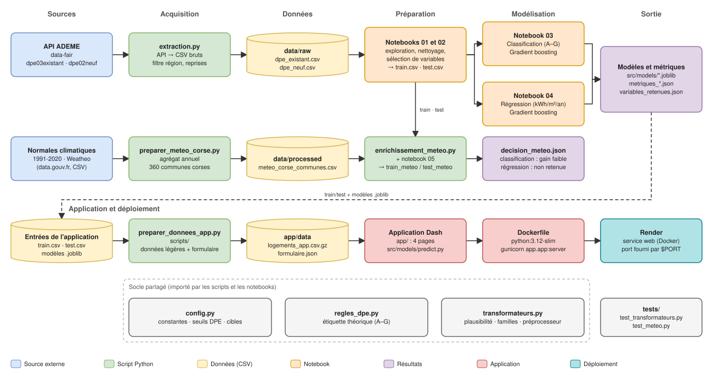

# DPE Corse — prédire l'étiquette DPE d'un logement (projet_ml_sise)


Projet de machine learning (M2 SISE) : à partir des caractéristiques d'un logement corse

Fait par 
* Serigne Saliou Thiam
* Yassine ZAHI

on estime

- **son étiquette DPE (A à G)** : classification ;
- **sa consommation en énergie primaire (kWhEP/m²/an)** : régression.

Les modèles alimentent une **application web Dash** (« DPE Corse »), conteneurisée avec Docker pour un déploiement sur **Render**. Les données viennent de l'API ADEME (DPE des logements existants et neufs, ≈ 49 000 logements en Corse).

## 1. Principe

1. **Récupérer** les DPE de la région via l'API, sans nettoyage (`data/raw`).
2. **Préparer** : écarter les valeurs impossibles, regrouper les libellés trop détaillés, sélectionner les variables, découper en train/test (80/20).
3. **Éviter les fuites** : l'étiquette est calculée à partir de la consommation et des émissions de GES (la pire des deux classes). Ces valeurs ne servent jamais de variables explicatives, seulement de contrôle.
4. **Modéliser** : un gradient boosting pour chaque tâche, comparé à une référence naïve et à une piste CatBoost.
5. **Servir** : un script extrait des fichiers légers pour l'application, qui charge les modèles et répond dans le navigateur.

| Tâche | Modèle | Résultat sur le test |
|---|---|---|
| Classification | Gradient boosting | F1 macro 0,52 · exactitude 63,6 % · à une classe près 93,7 % |
| Régression | Gradient boosting | R² 0,78 · MAE 26,7 · RMSE 41,8 kWh/m²/an |
| Classification | CatBoost (piste) | F1 macro 0,52 · exactitude 66,4 % |

Référence naïve : F1 macro 0,08 et R² ≈ 0. La météo (température, précipitations par commune) apporte un gain faible en classification (F1 0,513 → 0,521) et aucun en régression (`src/models/decision_meteo.json`).

## 2. Architecture



*Schéma modifiable : [`docs/architecture.drawio`](docs/architecture.drawio) (à ouvrir avec [diagrams.net](https://app.diagrams.net)).*

- **Une seule source de vérité** : périmètre, colonnes, cibles et seuils se changent dans `src/utilis/config.py`.
- **Transformations importables** : elles vivent dans `src/data/transformateurs.py`, car un pipeline sauvegardé avec joblib ne garde qu'une référence vers ses fonctions. Elles doivent donc être présentes dans l'image Docker.
- **Pas de fuite train/test** : le préprocesseur scikit-learn est ajusté sur le train uniquement.
- **Application découplée** : elle ne lit jamais `train.csv` ni `test.csv`, seulement les deux fichiers légers de `app/data/`.

## 3. L'application

Quatre pages (`app/pages/`) : **Contexte**, **Exploration** (filtres par étiquette, énergie de chauffage, type de bâtiment, surface, département), **Carte** (consommation médiane et part de passoires F/G par commune) et **Prédiction**.

La page Prédiction envoie la saisie à `src/models/predict.py` (classe `Predicteur`, chargée une seule fois par processus). Elle affiche l'étiquette, les probabilités par classe, la consommation estimée avec une fourchette (80 % des erreurs du test) et les variables qui pèsent le plus. Les champs vides sont traités comme « inconnu ». Pour expliquer une estimation, on remplace une variable à la fois par sa valeur de référence et on mesure l'écart, en ignorant les interactions.

`scripts/preparer_donnees_app.py` produit `app/data/logements_app.csv.gz` (≈ 0,7 Mo, une ligne par logement, position moyenne de la commune, sans adresse) et `app/data/formulaire.json` (valeurs possibles, références, erreurs typiques).

## 4. Déploiement (Docker / Render)

```bash
docker build -t dpe-corse .
docker run --rm -p 8050:8050 dpe-corse          # http://localhost:8050
```

- **Image** : `python:3.12-slim`, dépendances de `requirements-app.txt`, utilisateur sans privilèges, `gunicorn app.app:server` avec 1 processus et 4 fils (les modèles sont chargés une fois, timeout 120 s).
- **Render** : service web de type Docker, construit depuis le `Dockerfile` à la racine. Le port est lu dans `$PORT` (8050 par défaut).
- **À fournir avant la construction** : `src/models/modele_classification.joblib`, `src/models/modele_regression.joblib`, `app/data/logements_app.csv.gz` et `app/data/formulaire.json`. Sans les modèles, la page Prédiction affiche « Modèles introuvables ».
- **Version de scikit-learn** : un fichier joblib se recharge avec la version qui l'a produit, à figer dans `requirements-app.txt`.

## 5. Structure du dépôt

```
projet_ml_sise/
├── app/           application Dash : app.py, pages/, graphiques.py, composants.py, donnees.py,
│                  libelles.py, assets/ · data/ (logements_app.csv.gz, formulaire.json)
├── notebooks/     01 exploration · 02 prétraitement · 03 classification · 04 régression
│                  05 météo · 06 interprétation · audit_variables_yassine (CatBoost)
├── scripts/       preparer_donnees_app.py
├── src/
│   ├── data/      extraction · transformateurs · préparation et enrichissement météo
│   │              raw/ · processed/ (train.csv, test.csv…)
│   ├── models/    predict.py · modèles .joblib · metriques_*.json · variables_retenues*.json
│   └── utilis/    config.py · regles_dpe.py
├── models/        resultats_yassine_catboost.json
├── tests/         test_transformateurs.py · test_meteo.py
├── Dockerfile · requirements.txt (travail) · requirements-app.txt (application)
```

## 6. Développement local

Prérequis : Python ≥ 3.9 (3.12 dans l'image). Commandes à lancer **depuis la racine**.

```bash
python -m venv .venv && source .venv/bin/activate
pip install -r requirements.txt -r requirements-app.txt pytest

python -m src.data.extraction --jeu tous        # téléchargement → src/data/raw/
# notebooks 01 → 04 : produisent train/test et les modèles dans src/models/
python src/data/preparer_meteo_corse.py          # optionnel : météo (voir SOURCE_METEO.md)
python scripts/preparer_donnees_app.py           # fichiers légers de l'application
python -m app.app                                # http://127.0.0.1:8050
python -m pytest tests
```

Le CSV des normales climatiques (`fr_climate_normals_1991_2020.csv`) se télécharge à part et se place dans `src/data/raw/`.

## 7. Conventions techniques

- **Variables** : 23 (6 numériques, 17 catégorielles), listées dans `variables_retenues.json`. Valeurs manquantes imputées (médiane ou « inconnu »), modalités rares regroupées.
- **Nettoyage** : valeurs impossibles remplacées par NaN, consommation aberrante au-delà de 1 000 exclue, doublons exacts supprimés.
- **Fuites** : `etiquette_ges` et `ubat_w_par_m2_k` exclues.
- **Reproductibilité** : graine 42, découpage 80/20, identifiants du découpage dans `split_ids.csv`.
- **Évaluation** : validation croisée sur le train, test final avec intervalle à 95 %.

## 8. Limites connues

- **Modèles absents du dépôt** : `.gitignore` exclut `*.joblib` car ils sont trop lourd pour les mettre sur le github.  si vous vous l'avoir il faut réentrainer le model en locla.
- **Classes F/G mal détectées** : rappel de 30 % avec CatBoost et biais de −135 kWh/m² sur la classe G.
- **Décision météo ambiguë** : retenue en classification (gain de 0,009, du même ordre que l'écart-type entre plis), mais absente de la liste de variables des modèles.
## 9. Sources

- DPE : [ADEME, plateforme data-fair](https://data.ademe.fr) (`dpe03existant`, `dpe02neuf`).
- Météo : normales climatiques 1991-2020 par commune, Weatheo (ERA5-Land), licence CC BY 4.0.
