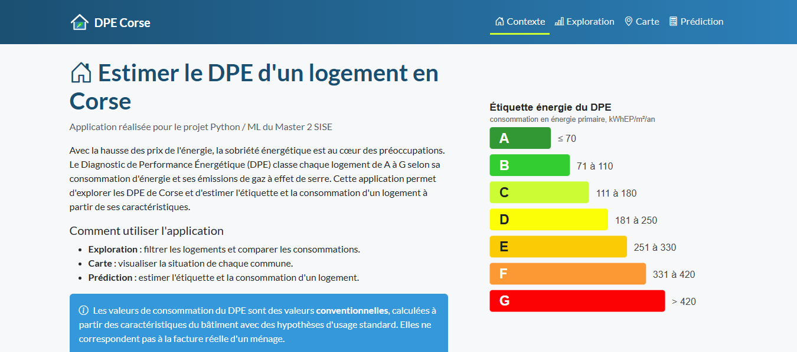
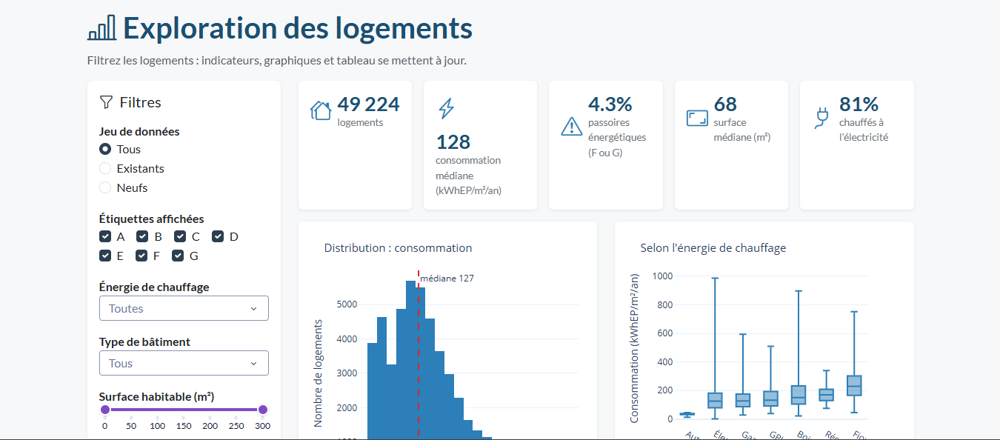
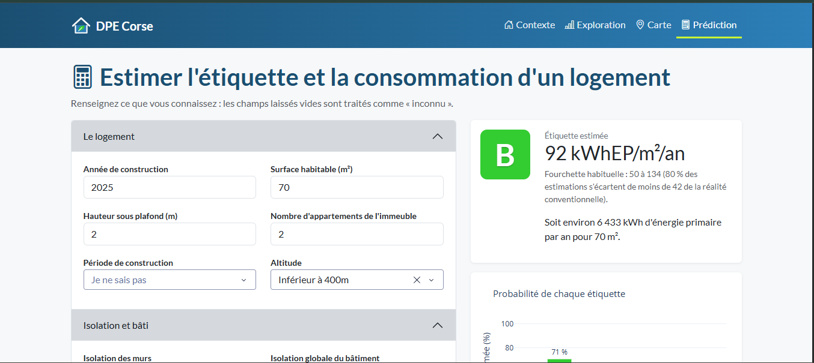
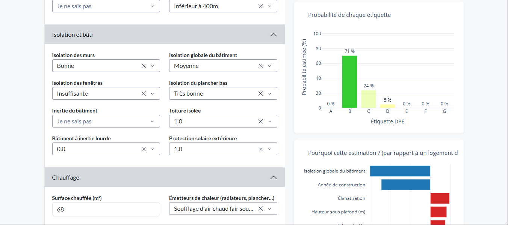

# DPE Corse — Guide d'utilisation

**DPE Corse** est une application web qui permet d'**explorer les diagnostics de performance énergétique (DPE) des logements corses** et d'**estimer l'étiquette et la consommation d'un logement** à partir de ses caractéristiques.

Application en ligne : <https://dpe-corse-latest.onrender.com/>

> Hébergée sur une offre gratuite, l'application peut mettre un moment à s'ouvrir après une période d'inactivité, et le nombre de requêtes est limité.

La **barre de navigation** en haut de chaque page permet de passer de l'une à l'autre.

| Page | Objectif |
|---|---|
| **Accueil** (Contexte) | Comprendre le projet et découvrir les grandes tendances des données |
| **Exploration** | Filtrer les logements, comparer, télécharger les données |
| **Carte** | Voir la situation de chaque commune sur une carte |
| **Prédiction** | Estimer l'étiquette et la consommation d'un logement |

## 1. Fonctionnalités communes

- **Graphiques interactifs** : survol pour lire les valeurs, zoom, plein écran, téléchargement en **PNG**, partage.
- **Filtres dynamiques** : indicateurs, graphiques et tableaux se mettent à jour dès qu'un filtre change.
- **Export CSV** : données filtrées (Exploration) et liste des communes (Carte).
- **Réinitialisation** : un bouton remet les filtres à leur valeur d'origine.

## 2. Accueil

*Page d'accueil : présentation, mode d'emploi et échelle des étiquettes.*

La page présente l'application et rappelle que les consommations du DPE sont **conventionnelles** : calculées avec des hypothèses d'usage standard, elles ne correspondent pas à la facture réelle d'un ménage. L'**échelle des étiquettes**, à droite, donne les seuils de chaque classe, de **A** (≤ 70 kWhEP/m²/an) à **G** (> 420).

En descendant dans la page, on trouve :

- les **indicateurs clés** : nombre de logements, part de logements neufs, consommation médiane, part de **passoires énergétiques** (étiquettes F et G) ;
- la **répartition des étiquettes** de A à G ;
- la répartition **logements existants / neufs** (les logements existants dominent largement, environ 92 %) ;
- l'**évolution mensuelle** du nombre de DPE reçus ;
- un **aperçu des données** et un **dictionnaire** qui explique chaque colonne.

## 3. Exploration

*Exploration : filtres à gauche, indicateurs et graphiques à droite.*

1. **Filtrer** à gauche : jeu de données (tous, existants, neufs), étiquettes affichées, énergie de chauffage, type de bâtiment, surface habitable.
2. **Choisir l'indicateur étudié** : consommation (kWhEP/m²/an) ou émissions de gaz à effet de serre (kg CO₂/m²/an).
3. **Lire les résultats**, qui se mettent à jour à chaque changement :
   - cinq indicateurs : nombre de logements, consommation médiane, part de passoires, surface médiane, part de logements chauffés à l'électricité ;
   - quatre graphiques : distribution (histogramme avec la médiane en pointillé), comparaison selon l'énergie de chauffage (boîtes à moustaches), nuage de points et carte de chaleur ;
   - un tableau triable des logements sélectionnés.
4. **Télécharger** les données filtrées en CSV. Le tableau affiche les 500 premiers logements, mais le fichier contient toute la sélection.
5. **Réinitialiser** pour repartir de zéro.

## 4. Carte

Chaque commune est un marqueur sur une carte **OpenStreetMap**. Sa **taille** indique le nombre de logements et sa **couleur** l'indicateur choisi (part de passoires, consommation médiane ou nombre de logements).

1. **Filtrer** par jeu de données, étiquettes, département (Corse-du-Sud 2A, Haute-Corse 2B) et nombre minimum de logements par commune.
2. **Cliquer sur une commune** pour afficher son détail : nombre de logements, consommation médiane, part de passoires, surface médiane et **répartition des étiquettes** sous forme de graphique.
3. Consulter le **classement** des communes et le tableau détaillé, puis le **télécharger** en CSV.

## 5. Prédiction

*Prédiction : le formulaire à gauche, le résultat à droite.*

1. **Remplir le formulaire**, organisé en sections repliables : le logement, isolation et bâti, chauffage, eau chaude, ventilation et climatisation. Seule la **surface habitable** est obligatoire. Un champ laissé vide est traité comme « inconnu » (« Je ne sais pas » dans les listes).
2. Cliquer sur **Estimer**. Le bouton **Effacer** vide le formulaire.
3. **Lire le résultat** à droite.

*Suite du résultat : probabilité de chaque étiquette et explication de l'estimation.*

| Élément | Ce qu'il indique | Dans l'exemple |
|---|---|---|
| **Étiquette estimée** | La classe la plus probable | B |
| **Consommation** | Estimation en kWhEP/m²/an, et en kWh par an pour la surface saisie | 92 kWhEP/m²/an, soit environ 6 433 kWh/an pour 70 m² |
| **Fourchette habituelle** | Intervalle dans lequel tombent 80 % des estimations du modèle sur des logements de test | 50 à 134 |
| **Probabilité de chaque étiquette** | Part de chaque classe de A à G, en pourcentage. Une répartition étalée signale une estimation incertaine | B 71 %, C 24 %, D 5 % |
| **Pourquoi cette estimation ?** | Les variables qui pèsent le plus, par rapport à un logement de référence : une barre **rouge augmente** la consommation, une barre **bleue la diminue** | L'isolation globale la réduit, la climatisation l'augmente |

Si un message indique que la consommation estimée correspond plutôt à une autre classe, le logement est proche d'un seuil : l'étiquette officielle tient aussi compte des émissions de gaz à effet de serre.

## 6. À savoir

- **L'estimation est indicative** et ne remplace pas un diagnostic réalisé par un professionnel. Plus le formulaire est complet, plus elle est précise.
- **Le périmètre est la Corse** : les données et le modèle ne s'appliquent pas à d'autres régions.
- **Passoire énergétique** : logement d'étiquette F ou G.