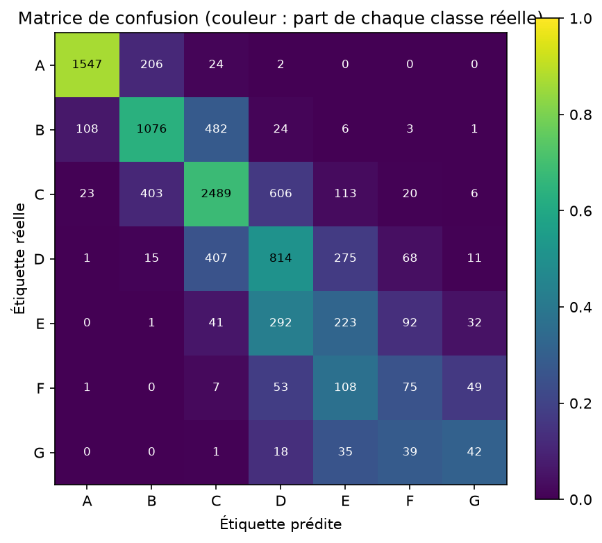
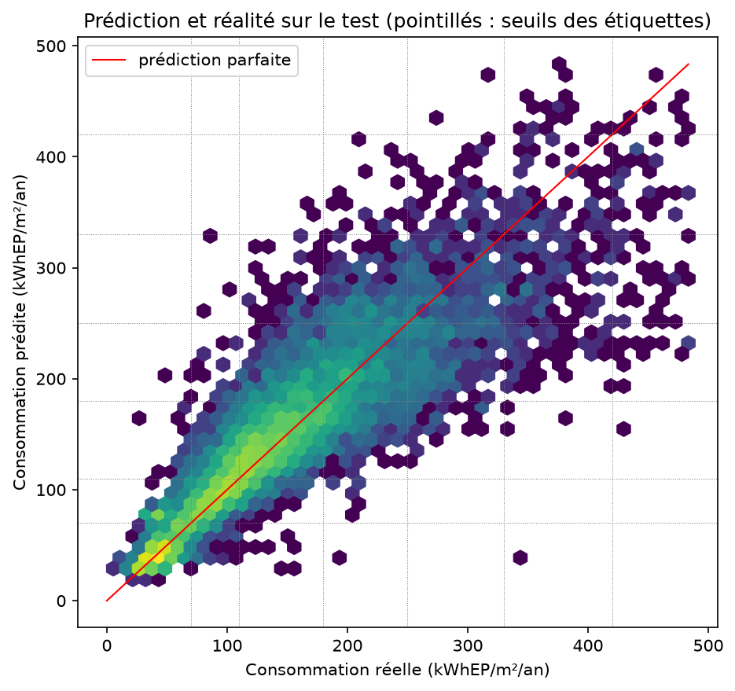

# Prédiction de la performance énergétique des logements en Corse

**Projet Python / Machine Learning — Master 2 SISE, Université Lumière Lyon 2 (2026–2027)**  
**Équipe : Yassine ZAHI et Serigne Saliou THIAM**  
**Rapport sur les modèles de Machine Learning — 23 novembre 2026**

## 1. Contexte et objectifs

Le diagnostic de performance énergétique (DPE) caractérise la performance d'un logement à partir de sa consommation **conventionnelle** d'énergie et de ses émissions de gaz à effet de serre (GES). Il ne correspond pas à la facture énergétique réelle des occupants. La classe énergétique, de **A** (très performante) à **G** (très énergivore), constitue un indicateur utile pour comparer les logements et identifier les passoires énergétiques.

Dans ce projet de M2 SISE, nous cherchons à estimer la performance de logements situés en **Corse**, à partir des caractéristiques de leurs bâtiments et équipements. Deux problèmes supervisés complémentaires sont traités :

- **Classification multiclasse :** prédire l'**étiquette DPE de A à G**.
- **Régression :** estimer la **consommation d'énergie primaire des cinq usages**, en **kWhEP/m²/an**.

Ces modèles alimentent une application web interactive. Notre démarche vise à obtenir des performances mesurables, mais aussi à identifier les limites des prédictions, notamment sur les logements des classes rares **F et G**.

## 2. Données et préparation

### 2.1. Collecte, périmètre et exploration

Les observations proviennent des jeux publics de l'**ADEME**, *DPE logements existants* et *DPE logements neufs*, interrogés par API puis filtrés sur la Corse (départements **2A et 2B**). La base préparée contient **49 226 DPE**, répartis entre **39 387 observations d'entraînement** et **9 839 de test** (environ 80/20). Pour les visualisations de l'application et la régression, deux observations avec consommation aberrante ont été écartées de l'entraînement : l'application présente donc **49 224 logements**.

Le jeu reste déséquilibré : la classe **C représente environ 37,2 %** des logements, contre **4,3 % pour les classes F et G réunies**. Les logements existants constituent environ **92,4 %** des données visualisées. La consommation médiane est proche de **128 kWhEP/m²/an**. Ces répartitions justifient une évaluation par classe, au-delà de l'exactitude moyenne.

### 2.2. Nettoyage et sélection des variables

La préparation comprend le contrôle des incohérences, le traitement des valeurs manquantes, le regroupement des modalités rares ou détaillées, la suppression des doublons exacts et la sélection de variables. Les informations qui révèlent directement le résultat énergétique — notamment les mesures de consommation et les émissions servant au calcul de l'étiquette — sont **exclues des variables explicatives**, afin d'éviter une fuite de cible.

La sélection finale comprend **23 caractéristiques** : **6 numériques** (année de construction, surfaces, hauteur sous plafond, capacité de stockage d'eau chaude, nombre d'appartements) et **17 catégorielles** (isolation, ventilation, énergie et équipements de chauffage, eau chaude, altitude et caractéristiques du bâti). Les colonnes trop incomplètes, redondantes ou peu informatives ont été retirées. Les valeurs manquantes sont prises en charge par le prétraitement intégré aux pipelines.

### 2.3. Protocole d'évaluation

La séparation entre entraînement et test tient compte des **adresses**, pour éviter que plusieurs diagnostics d'un même bâtiment se retrouvent dans des ensembles différents. Les expériences sont comparées par **validation croisée à cinq plis, stratifiée et groupée par adresse**, avec une attention particulière aux classes DPE et à la provenance neuf/existant. Les transformations sont ajustées sur les données d'entraînement, puis appliquées à la validation.

Le jeu de test sert à mesurer la performance finale des candidats. Les recherches de paramètres et les variantes sont étudiées prioritairement sur l'entraînement ; les scores issus de protocoles différents sont explicitement distingués ci-dessous.

## 3. Construction et choix des modèles

### 3.1. Classification

Le notebook initial compare une référence naïve (prédire toujours la classe majoritaire), la **régression logistique**, la **forêt aléatoire** et le **Gradient Boosting**. La métrique principale est le **F1-score macro**, moyenne des F1 des sept classes : il évite qu'une bonne prédiction des classes majoritaires masque des résultats médiocres sur les classes rares. Nous suivons également l'exactitude, le **rappel F/G**, la précision F/G et les résultats sur les logements neufs.

En validation croisée initiale, les F1 macro moyens sont de **0,486** (régression logistique), **0,520** (forêt aléatoire) et **0,519** (Gradient Boosting). Malgré le très faible avantage initial de la forêt, le **Gradient Boosting** a été choisi pour l'application en raison de performances proches et d'un modèle plus léger à déployer. La recherche de paramètres a retenu `learning_rate = 0,1` et `max_leaf_nodes = 63`.

L'audit complémentaire a comparé **M10 CatBoost** sans pondération des classes et **M11 CatBoost Balanced**, sur les 23 caractéristiques. Il permet d'étudier un compromis important : mieux détecter les passoires F/G peut entraîner davantage de fausses alertes ou dégrader d'autres classes.

### 3.2. Régression

Pour la consommation, les méthodes évaluées comprennent une référence par **médiane**, la **régression Ridge**, la **forêt aléatoire**, le **Gradient Boosting** et un modèle complémentaire **M9 CatBoost**. La métrique principale est la **MAE** (*Mean Absolute Error*), c'est-à-dire l'erreur absolue moyenne en kWhEP/m²/an. La **RMSE** pénalise davantage les erreurs importantes ; le **R²** mesure la part de variabilité expliquée.

Le Gradient Boosting est le meilleur de la comparaison initiale (MAE moyenne en validation croisée de **27,55**, contre **29,46** pour la forêt aléatoire et **36,67** pour Ridge). Après réglage, la configuration retenue est `learning_rate = 0,1`, `max_iter = 300`, `max_leaf_nodes = 63`. **Deux modèles Gradient Boosting distincts** sont donc utilisés dans l'application : l'un pour classifier le DPE, l'autre pour estimer la consommation.

## 4. Résultats et interprétation

### 4.1. Performances des modèles déployés sur le test

| Tâche | Modèle déployé | Principaux résultats sur 9 839 DPE de test |
|---|---|---|
| **Classification A–G** | **Gradient Boosting** | **F1 macro = 0,5199** ; **exactitude = 63,58 %** ; **93,69 %** à une classe près |
| **Régression** | **Gradient Boosting** | **MAE = 26,70** ; **RMSE = 41,82 kWhEP/m²/an** ; **R² = 0,776** |

Pour situer ces résultats, la référence naïve en classification n'obtient que **0,0775** de F1 macro. En régression, la prédiction systématique de la médiane donne une **MAE de 65,00**, contre **26,70** pour le modèle choisi. Le Gradient Boosting réduit donc nettement l'erreur moyenne, tout en restant imparfait sur les cas difficiles.

*Figure 1 — Matrice de confusion issue du notebook de classification. Les erreurs ne se répartissent pas uniformément entre les sept classes.*

### 4.2. Comparaison avec CatBoost et difficulté des classes F/G

| Classification : modèle | F1 macro (test) | Exactitude (test) | Observation |
|---|---:|---:|---|
| **Gradient Boosting déployé** | **0,5199** | **63,58 %** | Modèle retenu pour l'application |
| **M10 CatBoost, 23 variables** | **0,5220** | **66,37 %** | Alternative expérimentale, non déployée |

CatBoost M10 progresse légèrement en F1 macro, mais détecte difficilement les logements très énergivores : sur le test, sa **précision F/G est de 72,47 %**, pour un **rappel F/G de 30,14 %**. Autrement dit, il manque **299 des 428 logements réellement classés F ou G**. En validation croisée, M11 Balanced atteint un rappel F/G moyen de **71,64 %**, contre **32,29 %** pour M10 ; cependant sa précision F/G tombe à **40,49 %**, et son rappel pour les logements neufs de classe C est nul sur les cinq plis. M11 n'a donc pas été retenu comme modèle principal.

En régression, **M9 CatBoost** obtient une **MAE globale de 27,54**, légèrement supérieure à celle du Gradient Boosting (**26,70**). Sur les seules classes F/G, les MAE sont presque identiques : **96,26** pour M9 et **96,34** pour le Gradient Boosting (calcul pondéré à partir des 293 logements F et 135 logements G du test). Ce constat confirme le choix du Gradient Boosting pour sa meilleure performance globale.

*Figure 2 — Confrontation des consommations observées et prédites dans le notebook de régression.*

L'erreur augmente avec la consommation : pour le Gradient Boosting, la MAE est de **75,69** en classe F et de **141,17 kWhEP/m²/an** en classe G. Les très fortes consommations restent donc un point faible. Dans l'application, les résultats sont présentés comme des **estimations indicatives**, non comme des DPE réglementaires.

## 5. Expériences d'enrichissement OpenData

Les normales climatiques mensuelles **1991–2020** issues d'une source OpenData ont été préparées pour les **360 communes de Corse**, puis rapprochées des DPE avec **100 % de couverture**. Des premières variantes utilisant la **température annuelle moyenne** et les **précipitations annuelles** ont été évaluées. Dans le notebook météo, un Gradient Boosting testé avec ces deux variables atteint un F1 macro de **0,5206** sur le test, contre **0,5135** pour son témoin sans météo. La régression ne montre pas de gain suffisamment convaincant. Cette comparaison porte sur une expérience distincte du modèle Gradient Boosting déployé.

Nous avons ensuite calculé une **24ᵉ variable** : la température moyenne de **décembre, janvier et février**, à partir des normales mensuelles de chaque commune. Avec les mêmes cinq plis de validation et le même CatBoost M10, les résultats sont :

| Indicateur — validation croisée (5 plis) | M10 : 23 variables | M10 + hiver : 24 variables |
|---|---:|---:|
| **F1 macro moyen** | 0,5229 | **0,5266** |
| **Rappel F/G** | 32,29 % | **33,70 %** |
| **F1 F/G** | 0,4371 | **0,4492** |
| **F1 des logements neufs A/B/C** | 0,6892 | **0,6927** |

Le **F1 macro progresse sur chacun des cinq plis**, de façon modeste (**+0,0037** en moyenne). Cela soutient l'intérêt de la variable hivernale, mais ne démontre ni une amélioration statistiquement certaine ni un gain sur un test final indépendant. Les valeurs météorologiques étant communes à tous les logements d'une même commune, elles peuvent aussi capter des particularités géographiques plutôt qu'un effet climatique direct.

**Décision pour la livraison :** les résultats météo sont conservés comme **expériences d'amélioration**, mais **les deux modèles déployés restent les Gradient Boosting à 23 variables, sans météo**. Une évolution possible serait de proposer dans l'application une comparaison entre modèles avec et sans enrichissement climatique, après entraînement et validation complets des modèles supplémentaires.

## 6. Mise en application, limites et conclusion

Les modèles entraînés sont sauvegardés dans **deux fichiers `.joblib`**, appelés par la page **Prédiction** de l'application **Dash**, conteneurisée avec **Docker** et déployée sur **Render**. L'utilisateur décrit un logement, puis obtient une étiquette A–G, les probabilités par classe, la consommation estimée, une fourchette indicative issue des erreurs observées sur le test et un graphique d'explication par comparaison à un logement de référence. Les autres pages (**Contexte**, **Exploration**, **Carte**) permettent de consulter les indicateurs, les graphiques et la répartition géographique des DPE.

Les deux estimations sont **indépendantes** : l'étiquette prédite ne correspond pas toujours à la classe déduite de la seule consommation estimée, notamment parce que le DPE tient également compte des GES. Les explications fournies par le modèle indiquent des **associations prédictives**, pas des effets causaux d'une rénovation. Les incertitudes sont plus fortes sur les classes rares et les consommations extrêmes ; les modèles reproduisent un calcul de consommation conventionnelle, non les usages réels d'un ménage.

**En conclusion**, la chaîne mise en place — collecte ADEME, préparation, sélection de 23 variables, validation groupée, comparaison et déploiement — fournit une application opérationnelle de prédiction énergétique. Les **deux Gradient Boosting** offrent un compromis entre performance, taille des artefacts et facilité d'intégration. Les essais CatBoost et météo, en particulier la température d'hiver, documentent des pistes d'amélioration mesurées mais **non encore intégrées** à la version en ligne. La priorité pour une version ultérieure serait d'améliorer la reconnaissance des passoires F/G, de fiabiliser les estimations des fortes consommations et de comparer rigoureusement les modèles enrichis.

---

**Sources et reproductibilité.** Dépôt du projet : [SaliouThiam/projet_ml_SISE](https://github.com/SaliouThiam/projet_ml_SISE). Notebooks : `02_preprocessing_selection.ipynb`, `03_modele_classification.ipynb`, `04_modele_regression.ipynb`, `05_enrichissement_meteo.ipynb` et `audit_variables_yassine.ipynb`. Métriques : `src/models/metriques_classification.json`, `src/models/metriques_regression.json`, `models/resultats_yassine_catboost.json`. Données : [ADEME](https://data.ademe.fr) ; climat : [normales climatiques 1991–2020 par commune](https://www.data.gouv.fr/datasets/normales-climatiques-mensuelles-1991-2020-par-commune-france). Application : [DPE Corse — Render](https://dpe-corse-latest.onrender.com/).
